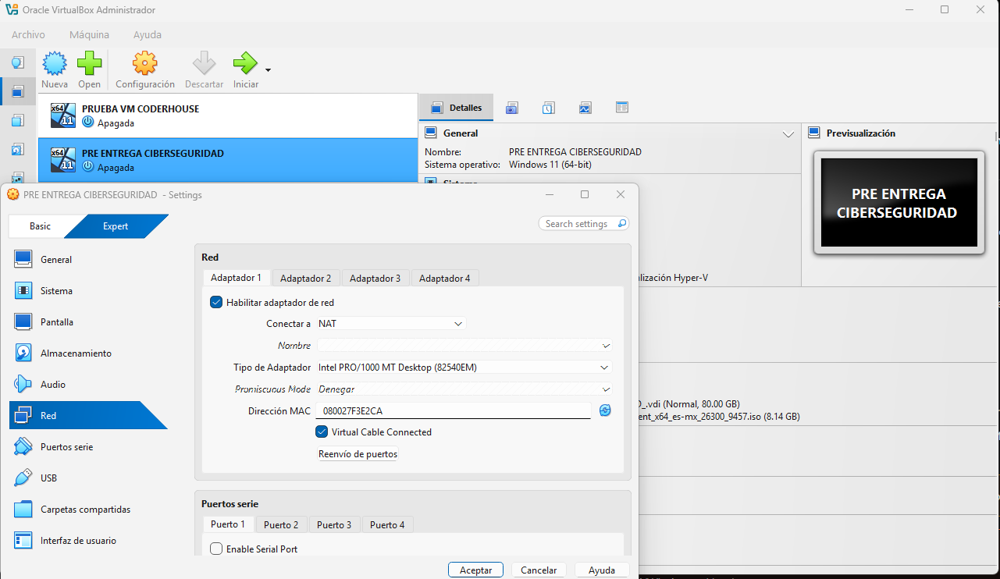
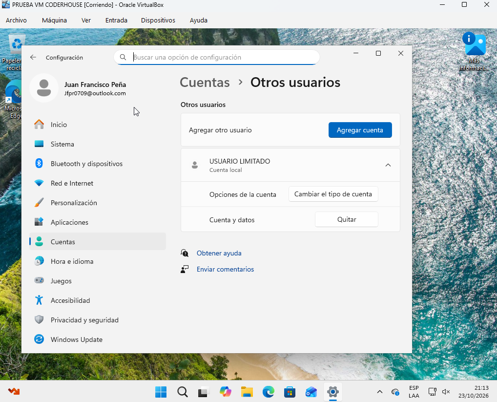
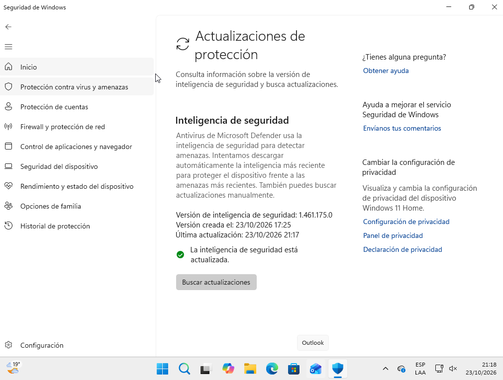
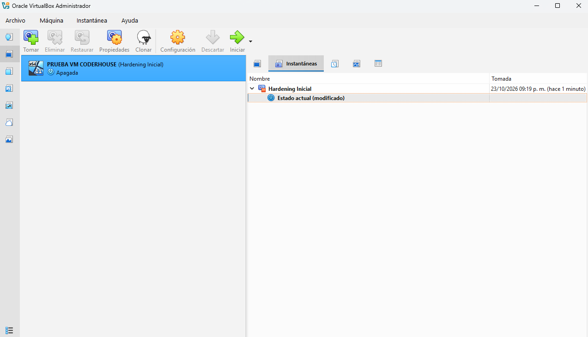

# Pre-entrega 2: Laboratorio Seguro de Ciberseguridad

**Autor:** Juan Francisco Peña
**Sistema operativo de la VM:** WINDOWS 11 START 

## Resumen

Creé una máquina virtual de prácticas en VirtualBox con red en modo NAT, un usuario limitado, el sistema operativo actualizado y un snapshot inicial como punto de restauración.

---

## 1. Red en modo NAT

**Qué hice:** Antes de iniciar la VM, fui a *Configuración → Red → Adaptador 1* y verifiqué que estuviera en modo **NAT**.

**Por qué es importante:** Con NAT la VM puede salir a internet (por ejemplo, para actualizarse) usando la IP del host, pero nadie desde afuera puede iniciar conexiones hacia ella. Esto protege tanto a la VM como a mi equipo real.

---

## 2. Usuario con permisos limitados

**Qué hice:** Creé el usuario `USUARIO LIMITADO` sin privilegios de administrador. En la captura se ven los usuarios del sistema.

**Por qué es importante:** Aplica el principio de mínimo privilegio: si un malware o un error se ejecuta con este usuario, no puede modificar el sistema ni instalar software con permisos elevados.

---

## 3. Sistema actualizado

**Qué hice:** Ejecuté Windows update y verifiqué que el sistema quedó actualizado.

**Por qué es importante:** Las actualizaciones corrigen vulnerabilidades conocidas, que son uno de los vectores de ataque más comunes.

---

## 4. Snapshot "Hardening Inicial"

**Qué hice:** Apagué la VM y creé un snapshot llamado **Hardening Inicial**.

**Por qué es importante:** Es un punto de restauración limpio y configurado. Si durante las prácticas el sistema se rompe o se infecta, puedo volver a este estado en segundos.

---

## Conclusión

En este laboratorio aprendí a crear una máquina virtual segura para practicar ciberseguridad. Configuré la red en modo NAT para proteger mi equipo real, creé un usuario con permisos limitados, actualicé el sistema y guardé un snapshot para poder volver atrás si algo sale mal. Estos pasos son la base para trabajar de forma segura en las próximas prácticas.
